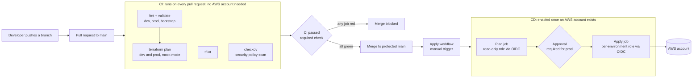
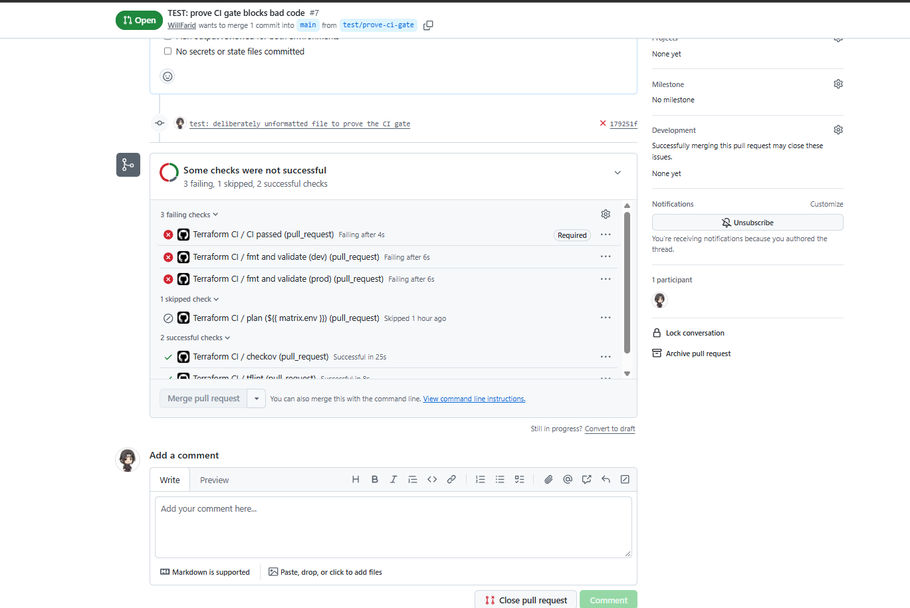
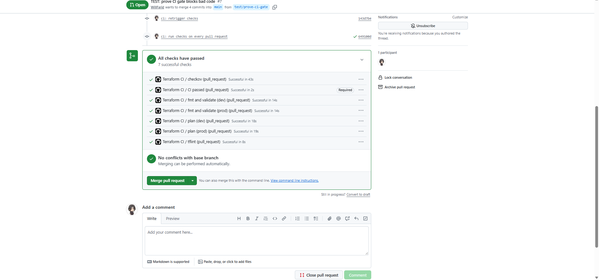

# Terraform CI/CD with Security and Policy Gates

[](https://github.com/WillFarid/terraform-CI-CD-with-security-and-policy-gates/actions/workflows/terraform-ci.yml)

A GitHub Actions pipeline that checks, scans and plans a multi-environment AWS Terraform codebase on every pull request, blocks the merge when anything fails, and deploys through approval-gated environments using short-lived OIDC credentials instead of stored AWS keys.

The infrastructure it protects is a 3-tier AWS architecture (VPC, ALB, Auto Scaling, encrypted RDS) from my [first project](https://github.com/WillFarid/aws-3tier-terraform-project).

> **Status.** The CI half is live and runs with no AWS account. The deployment half (OIDC roles and the apply workflow) is fully written and validated, but **has not been exercised against a real AWS account**. It stays switched off until one is connected (see [Enabling deployment](#enabling-deployment)).

## Pipeline



## Screenshots

| A deliberately unformatted file is caught | The fix goes green |
|---|---|
|  |  |

## What runs on every pull request

| Job | What it checks |
|---|---|
| **fmt and validate** | Formatting and syntax for `dev` and `prod` |
| **validate (bootstrap)** | Syntax of the OIDC bootstrap stack |
| **tflint** | AWS-aware linting (invalid settings, unused variables, deprecated syntax) |
| **checkov** | Security scan of the modules, `prod` and `bootstrap` |
| **plan (dev, prod)** | `terraform plan` offline, with a summary comment on the pull request and the full plan as a downloadable artifact |
| **CI passed** | One final job that requires all of the above. It is the only required status check. |

The same tools run locally on every commit through pre-commit, so most problems are caught before they reach GitHub.

## Design decisions

| Decision | Why |
|---|---|
| **One required check (`CI passed`)** | Branch protection depends on a single job that waits for all the others, so jobs can be added or renamed without editing the rule. |
| **Runs on every pull request, no path filter** | A path filter would leave a required check waiting forever on pull requests that touch no matching file. I hit this exact bug while testing the gate and removed the filter. |
| **Works without an AWS account** | The provider runs in mock mode and the S3 backend is swapped for a local one inside the runner, so plans are real and need no credentials. |
| **OIDC instead of access keys** | A workflow asks GitHub for a signed token and AWS exchanges it for credentials that last one hour. There is no secret to leak or rotate. |
| **Three roles, scoped by token claims** | The plan role is read-only and works from pull requests. Each apply role can only be assumed by a job running in its own GitHub Environment. A forked repository cannot satisfy the trust policy. |
| **The plan role cannot change state** | It can read state and create or delete the lock file only. |
| **Each apply role sees only its own state** | The dev role cannot read or change the prod state. |
| **Plan, approve, then apply the same plan** | The apply job uses the saved plan file from the plan job, so what a reviewer approves is exactly what is deployed. |
| **Approval before the prod job starts** | The prod job runs in a protected environment, so GitHub pauses for a reviewer before any prod credentials are issued. |
| **Least-privilege workflow permissions** | The workflow defaults to read-only. Only the plan job may comment on pull requests, and only the CD jobs may request OIDC tokens. |
| **Pinned tool versions** | Terraform, tflint and checkov match the versions used locally, so results are the same on a laptop and in CI. |
| **Dependabot and CODEOWNERS** | GitHub Actions versions update through reviewed pull requests, and every change needs the owner's review. |

## Repository structure

```text
.
├── .github/
│   ├── workflows/
│   │   ├── terraform-ci.yml       # checks on every pull request
│   │   └── terraform-apply.yml    # manual, approval-gated deployment
│   ├── CODEOWNERS
│   ├── dependabot.yml
│   └── pull_request_template.md
├── bootstrap/                     # one-time stack: OIDC provider and the 3 roles
├── modules/                       # reusable modules (vpc, security-groups, alb, compute, rds)
├── environments/
│   ├── dev/
│   └── prod/
├── .pre-commit-config.yaml
├── .tflint.hcl
└── .checkov.yaml
```

## Enabling deployment

This needs an AWS account and is deliberately off by default. With `AWS_ENABLED` unset, the apply workflow runs and skips both jobs.

1. Create the S3 state bucket (versioning, encryption and public access block on) and put its name in each `backend.tf` and in `bootstrap/variables.tf`.
2. Apply `bootstrap/` once, from a laptop, with administrator credentials and `mock_mode = false`. It creates the OIDC provider and the three roles. The pipeline cannot create its own identities.
3. In GitHub, **Settings, Environments**, create `dev` and `prod`. On `prod`, add yourself under **Required reviewers**. On both, restrict **Deployment branches** to `main`.
4. Add the variables from the bootstrap outputs:
   - Repository variable `AWS_PLAN_ROLE_ARN` (the plan role)
   - Environment variable `AWS_APPLY_ROLE_ARN` inside `dev`, and another inside `prod` (each environment's apply role)
   - Repository variable `AWS_REGION` (optional, defaults to `us-east-1`)
5. Set the repository variable `AWS_ENABLED` to `true`.
6. Replace the placeholder ACM certificate and log bucket name in the environments, then run **Actions, Terraform Apply, Run workflow**.

## Honest limitations and what I would add next

- The deployment half is written and validated but not run against AWS.
- The apply roles use `PowerUserAccess` plus IAM limited to the project prefix. That is wider than ideal. In a real account I would run the pipeline once, then replace it with a policy generated from CloudTrail by IAM Access Analyzer.
- The apply workflow is manual. A production setup could deploy `dev` automatically after every merge.
- Next additions: Infracost cost estimates on pull requests, policy-as-code with OPA or Conftest, Terratest for module tests, a scheduled drift-detection plan, and pinning third-party actions to commit SHAs.

## Skills demonstrated

GitHub Actions (matrix builds, reusable gate pattern, least-privilege permissions, environments and approvals, artifacts, OIDC), Terraform multi-environment layout, DevSecOps tooling (tflint, checkov, pre-commit, terraform-docs), IAM trust-policy design, and branch protection with required status checks.

## 👩‍💻 Author

**Will Farid**, Cloud Engineer

## ⭐ Support

If you found this project useful, consider giving it a ⭐ on GitHub.
